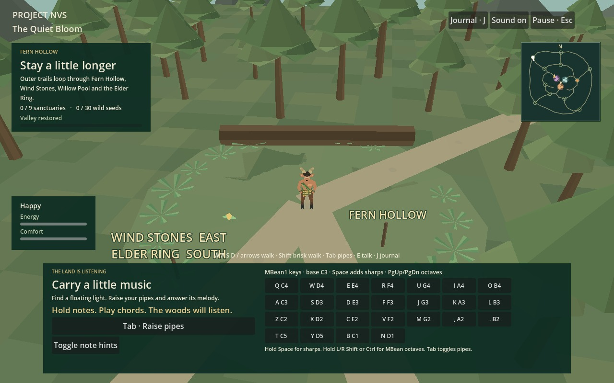
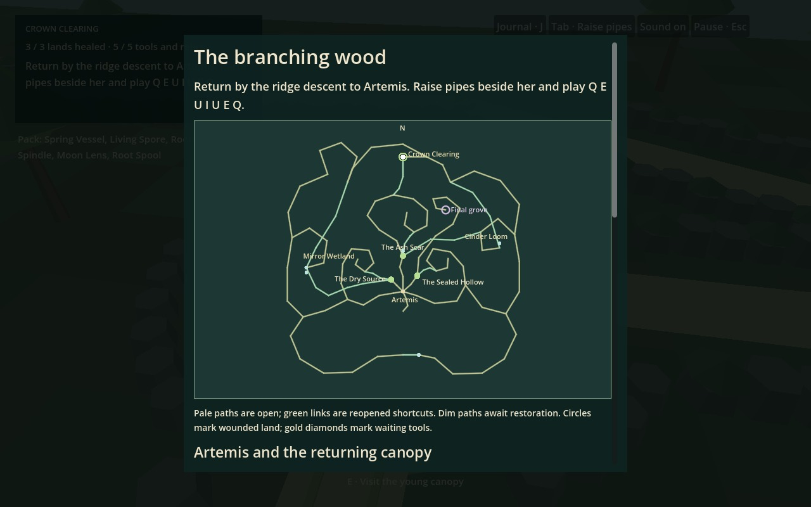
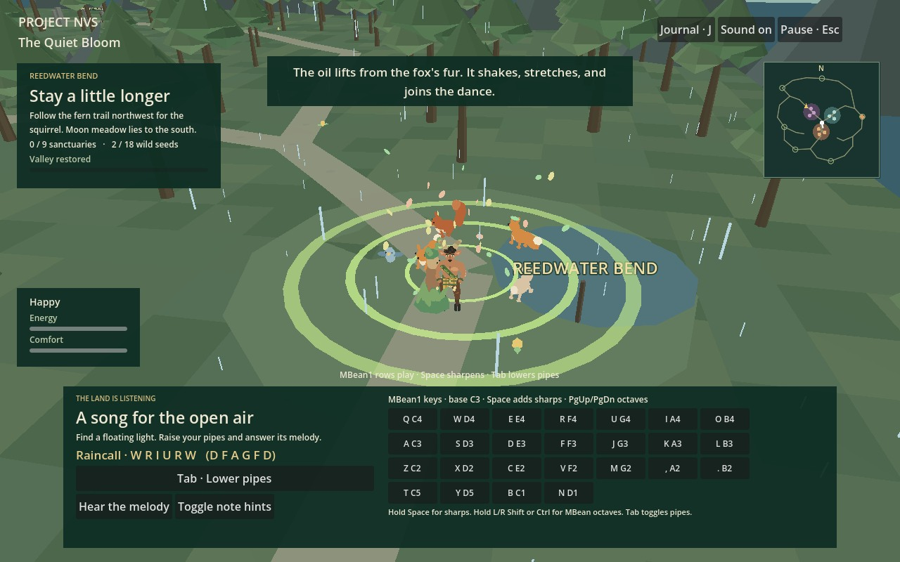

# Project NVS: The Quiet Bloom

A faun carries a set of wooden pipes into a wounded valley. Play the land's remembered melodies to loosen corruption, clear polluted water, and coax new growth from scorched earth.

**The Quiet Bloom** is the provisional title for Project NVS. The Godot edition combines adapted code from MBean1, Zendelves, and Lifesim with a wider woodland for quiet exploration, creature care, and free musical play.



## Open in Godot

This repository now includes the native **Godot 4.7.2** project at its root.

1. Download a fresh repository ZIP and extract it completely.
2. In Godot Project Manager, choose **Import** and select the root `project.godot`.
3. Open the project and press **F5** to play.
4. Choose **The Quiet Bloom** or **The Returning Wood** from the level selector. Each has its own Begin and Continue actions.

The Godot edition runs both 3D journeys, the animated faun, panpipes, journals, maps and native saves directly. No Node.js, local web server, browser, or extension is required. The first journey saves to `user://journey.json`; the second saves to `user://secondwood.json`. Browser saves remain separate.


A Windows Desktop export preset is included. Export templates are needed only when exporting a standalone executable, not for opening and playing the project in Godot.

## Level select and The Returning Wood 28 October 2026

The game now starts with two level cards. **The Quiet Bloom** keeps the existing valley, nine sanctuaries and open woodland. **The Returning Wood** is a separate journey built around long curling branches, healing tools and returns to earlier wounds. Both levels are available from the start. Begin replaces only the selected journey after a second click when a save already exists; Continue resumes that journey. Press Escape in either level and choose **Level select** to switch.

The Returning Wood now has fourteen primary paths and nine unlockable shortcuts, totaling 3,114.33 units of centerline inside 312 by 312 unit bounds. That is 3 times its previous bounded area and 2.91 times its route length. The original curls now connect to wetlands, burned woodland, a northern ridge and southern return walks.

| Tool | Where to find it | Where to return | What healing opens |
| --- | --- | --- | --- |
| Spring Vessel | Western curl | The Dry Source | Western shortcut and the northern spiral |
| Living Spore | Eastern curl | The Sealed Hollow | Eastern shortcut |
| Rootheart Spindle | Northern spiral, after healing the source | The Ash Scar | Northern shortcut |

Approach a tool to collect it. Lower the pipes and press **E** near its matching wound to heal the land. Tools stay in your pack. Water, new growth and returning woodland residents show what changed. After all three places recover, the route to the Joined Grove opens. Raise the pipes with **Tab** and play **Q E U I U E Q**, in any octave, to complete the original grove song. Artemis has a further request.

Press **J** with the pipes lowered for the route map, tool descriptions and places to revisit. Pale paths are open; dim paths remain closed by a wound. The second level reuses the native faun, full MBean1 keyboard, pipe audio and woodland cast, with its own quest inventory and route state. The [design addendum](docs/ProjectNVS_Woodland_Expansion.docx) records the human request and the implementation choices for this milestone.

At the Turning Glade, moonlight and drifting motes surround Artemis, who responds to the current stage of her quest. Squirrels appear along several walks, and pollen, glints, fireflies, embers and petals distinguish different regions. At the wetland bend, three frogs sit together with banjos. Approach them and press **E** to start or stop their tune. It also stops when you walk away, pause, mute sound or raise the pipes.

Their original 33-second tune, **Frog Lantern Rag**, is included as [MP3](assets/frog-lantern-rag.mp3) and as an editable [MBean1 score](assets/frog-lantern-rag.mbean.json). MBean1 has no banjo voice, so its score uses guitar editing proxies; the game's banjo-like sound is rendered separately by an original plucked-string model. The composition was checked from its score and waveform and has not had a human listening review.

Speak with the giant deer **Artemis** at the Turning Glade. Her quest asks you to heal the three wounds, reconnect the western and eastern ridge crossings, carry her acorn to **Crown Clearing**, then return along the new descent to play **Q E U I U E Q** beside her. Planting grows a young canopy and brings back small creatures. The grove song and Artemis's finale keep separate progress.

| Relic or return | Interaction |
| --- | --- |
| Moon Lens, Mirror Wetland | Bring the Spring Vessel to collect it, then press E at the restored Dry Source to attune it. Focus the western Moon Plinth with E, raise pipes and sustain natural D for 1.5 seconds. Any octave works; the on-screen Hold D toggle offers the same action. |
| Root Spool, Cinder Loom | Bring the Living Spore to wake it. Press E at the eastern bridge, then walk to and bind each of three numbered stumps with E. Partial work is saved. Reuse the Spool at the healed Ash Scar. |
| Wetland sluice | Reuse the Spring Vessel at the outer wetland to open a return to the Dry Source. |
| Southern latch | Reach the eastern end of the southern walk and press E to join both outer branches. |
| Artemis's acorn | Artemis gives it after the three healings and both ridge repairs. Plant it at Crown Clearing with the retained Rootheart Spindle. It cannot be dropped or wasted. |

Version 1 second-level saves migrate automatically. Earlier tools, wounds and valid saved positions remain intact; a finished old grove can still begin Artemis's new quest. The first valley continues to use its separate save.

Second-level native verification passes 104 continuous progression checks, 137 route checks and 48 isolated relic/save checks. The complete quest uses the real controller and physical musical keys, with no relocations. A separate route sweep checks every route in both directions. The floor-distance audit measures every shortcut with the other links already available. See [implementation notes](docs/ARTEMIS_IMPLEMENTATION.md), [progression results](docs/secondwood-progression-verification.json), [traversal results](docs/secondwood-traversal-verification.json) and [shortcut distances](docs/secondwood-shortcut-verification.json).



## Far woodland expansion 28 October 2026

The native map now covers **250 by 250 units**, up from 150 by 150. That is 2.78 times the previous bounded surface. Eleven connected trail sections total 1,602.91 units, with five new clearings and twelve more optional seeds. The full woodland now has eleven named clearings and thirty wild seeds.

The farther trails form an outer circuit with inward returns to Moonmere, the Listening Stones, Reedwater, Artemis' Meadow and the stump nursery. Look for signed paths to **Fern Hollow**, **Wind Stones**, **Willow Pool**, **Sunwash Meadow** and the **Elder Ring**. A fallen log, tall stones, a drooping willow, open flowers and old trees give those places different silhouettes. The long stretches between them leave room to walk and play music.

Press **J** with the pipes lowered to open the journal's labeled woodland map and route guide. The original seed positions and IDs remain intact, and Continue can restore a position in the new country. The nine sanctuaries, squirrel, Raincall, fox, nursery and Artemis still work within the expanded map. All collecting and farther exploration remain optional.

Native verification passes 264 assertions across the core, keyboard, collision-route, controller and woodland suites. The controller follows every trail forward and backward; additional checks cover off-trail walking, the world edges and saving beyond the former boundary. These checks do not establish first-time navigation or target-hardware frame rate. The [updated design addendum](docs/ProjectNVS_Woodland_Expansion.docx) records this pass and retains the earlier evidence as history.

## Woodland expansion 23 October 2026

The first woodland pass added 150 by 150 units of walkable country around the original valley, six connected trails, six named clearings, and 18 optional wild seeds. Those routes and discoveries remain inside the larger map described above. Long stretches are for walking and listening. The original nine sanctuaries and final heart song are still a complete journey; optional discoveries never gate them.

- Follow the squirrel from the northwestern Hollow Wood trail to Moonmere. It waits when you fall behind. At the end it teaches **Raincall**, W R I U R W (D F A G F D).
- Play Raincall anywhere after learning it for a 45-second shower. Take it to the southwestern stump nursery to grow small flowering plants around the old stumps over fourteen seconds.
- Find an oiled fox at Reedwater Bend in the east. Hear its phrase and play E W Q W E U to lift the oil and let it recover.
- Restored sanctuaries welcome hopping animals, a dancing dryad, expanding light rings and rising petals. Scorched sites grow young flowering shoots over five seconds rather than replacing stumps with mature trees.
- Speak with dryads in the western glade and stump nursery. After restoring three sanctuaries, visit Artemis' Meadow in the south to encounter a giant pale deer with branching antlers and a moon crown.



The instrument uses MBean1's actual computer-keyboard layout, held polyphony, a sharp modifier, and octave controls. The on-screen keyboard and note hints are available throughout exploration. **Tab raises or lowers the pipes; Space adds sharps while playing.** The old five-key Q W E R T layout has been replaced in Godot. Hide the phrase hints and use **Hear the melody** to practice by ear; free timing remains forgiving.

| MBean1 row | Natural notes at the default base octave |
| --- | --- |
| Q W E R U I O | C4 D4 E4 F4 G4 A4 B4 |
| A S D F J K L | C3 D3 E3 F3 G3 A3 B3 |
| Z X C V M , . | C2 D2 E2 F2 G2 A2 B2 |
| T Y and B N | C5 D5 and C1 D1 |
| Hold Space | Raise C, D, F, G and A by one semitone |
| Page Up / Page Down | Move the base octave, C1 through C6 |
| Hold left / right Ctrl | Use MBean1 base octaves C4 / C1 |
| Hold left / right Shift | Use MBean1 base octaves C5 / C2 |
| Hold Caps Lock | Use MBean1 base octave C6 |

Tab is reserved for changing instrument mode. J and E are musical keys while the pipes are raised; lower them to use the journal or talk/rest shortcut. Note releases, lowering the pipes, pause, focus loss and mute clean up sustained voices.

That first expansion left the rhythm note highway, Artemis' human form and the wider story conflict for later discussion. The [design addendum](docs/ProjectNVS_Woodland_Expansion.docx) preserves those ideas.

## Browser prototype

The original browser edition remains available as an earlier prototype. The woodland expansion and full keyboard described above are currently in Godot. To run it, use Node.js 20 or later:

```sh
npm start
```

Open [http://localhost:5173](http://localhost:5173). The Godot edition above is the default path for working on this project.

## Restore the valley

Follow the pale paths to the floating sanctuary lights. Raise your pipes with Tab, listen to the phrase, then play its displayed keys in order. The melody checks note order at your own pace. There is no timing window, score penalty, or game-over screen.

The Hollow Wood, the Bitter Marsh, and the Ember Orchard each contain three wounded sites. Their melodies grow from four to six notes. Every completed phrase changes the surrounding terrain, plants, and water. Restored sites gain flowers, returning butterflies, and a short woodland celebration.

After all nine sanctuaries recover, return to the central heart tree. Play its final seven-note melody to complete the journey. You can continue exploring and playing afterward.

| Control | Action |
| --- | --- |
| W A S D or arrow keys | Walk while your pipes are lowered |
| Left Shift | Walk briskly |
| Drag the scene | Orbit the camera |
| Mouse wheel | Zoom |
| Tab | Raise or lower the pipes |
| Space while playing | Sharp modifier |
| MBean1 rows above | Play notes and hold chords while the pipes are raised |
| Listen button | Hear the nearby sanctuary's phrase |
| E | Speak with nearby creatures or dryads; rest at the lantern camp |
| J | Open the journal and choose a sanctuary waypoint |
| Escape | Pause or resume |
| Sound button | Mute or unmute |

The on-screen note buttons work with a pointer. Small screens also show movement buttons. While the pipes are raised, all mapped keys play notes. Lower the pipes to use walking and resting controls.

Energy, comfort, and frustration change the faun's mood. They never prevent movement or music. A four-second rest at the lantern camp restores energy and comfort. Walking away cancels the rest.

## Your journey is saved here

The Quiet Bloom saves to `user://journey.json` every five seconds, after restoration, and when paused or closed. **Continue** restores position, sanctuary progress, needs, ending state, gathered seeds, squirrel progress, rain song, wildlife cleansing, nursery growth and the Artemis encounter. Version-one native saves receive safe defaults for the newer discoveries.

The Returning Wood keeps a separate `user://secondwood.json` with position, owned tools, healed places, elapsed time and completion. Open shortcuts follow the saved healing state. Starting or continuing either level leaves the other level's file alone. The browser prototype saves separately in the current browser.

## Watch a place recover

| Before the song | After the song |
| --- | --- |
|  |  |

## Scope of this version

This is a single-player exploration game with two selectable journeys. The first has an authored central valley and larger woodland, nine restoration sites, optional musical discoveries and a heart-tree ending. The second has branching routes, three reusable healing tools, three returning objectives, permanent shortcuts and a final grove song. Both share the procedural faun and live synthesized instrument. The game has no combat, building mode, multiplayer, or full music editor. The native instrument supports freely played chords, chromatic notes and several octaves; melody matching accepts notes across octaves at the player's own pace.

All models and terrain are generated in code. The music uses an authored synthesizer adapted from MBean1's reed voice. It contains no borrowed music recordings or downloaded instrument samples.

See [the architecture](docs/ARCHITECTURE.md), [the source reuse record](docs/SOURCE_REUSE.md), and [implementation progress](PROGRESS.md). Source links to the private projects require access to those repositories.

## Development commands

```sh
npm test
npm run check
```

These commands run 14 simulation, save, geometry, restoration, and route reachability checks, plus syntax checks. The browser journey and audio graph have separate replayable checks. For those development checks only, install Playwright and its Chromium browser, then run:

```sh
node tools/browser-smoke.mjs
node tests/audio-browser.cjs
```

Set `CHROMIUM_PATH` to use an existing browser executable. [Browser results](docs/browser-verification.json), [audio results](docs/audio-verification.json), and [PROGRESS.md](PROGRESS.md) record the verification performed on this version.


## Native verification and asset regeneration

Run the native integration test with Godot 4.7.2:

```sh
godot --headless --path . --script tests/godot_smoke.gd
godot --headless --path . --script tests/music_keyboard.gd
godot --headless --path . --script tests/woodland_routes.gd
godot --headless --path . --script tests/woodland_traversal.gd
godot --headless --path . --script tests/woodland_expansion.gd
godot --headless --path . --script tests/secondwood_progression.gd
godot --headless --path . --script tests/secondwood_traversal.gd
godot --headless --path . --script tests/secondwood_relics.gd
godot --headless --path . --script tests/frog_banjo.gd
godot --headless --path . --script tests/woodland_life.gd
godot --headless --path . --script tests/secondwood_ambience_integration.gd
godot --headless --path . --script tools/audit-secondwood.gd
python tools/audit-secondwood-shortcuts.py
```

These exercise the native scene, movement input, all nine sites, the ending, actual save/Continue, malformed save handling, rest, held music, optional discoveries, rain, creature cleansing, Artemis and native PCM audio data. The route audit samples 3,513 collision points; the controller traverses all eleven trails forward and backward, plus off-trail and world-edge probes. The integration journey relocates the faun between discoveries and lets the squirrel move through its actual update loop; it also saves and resumes in the new country. This is not a first-time navigation or target-hardware performance test. See [Godot verification](docs/godot-verification.json) and [native port notes](docs/GODOT_PORT.md).

Native meshes and generated pipe samples are included in `assets/`. They can be regenerated during development from the browser source with `node tools/bake-native.mjs` and `python tools/bake-native-audio.py`. Regeneration is optional for playing or editing the native gameplay scripts.
