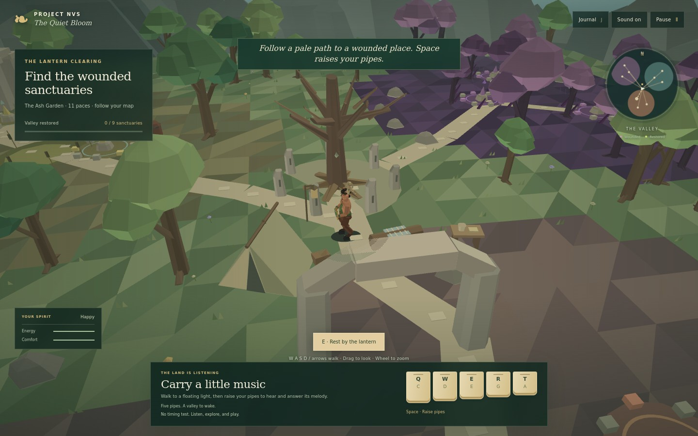
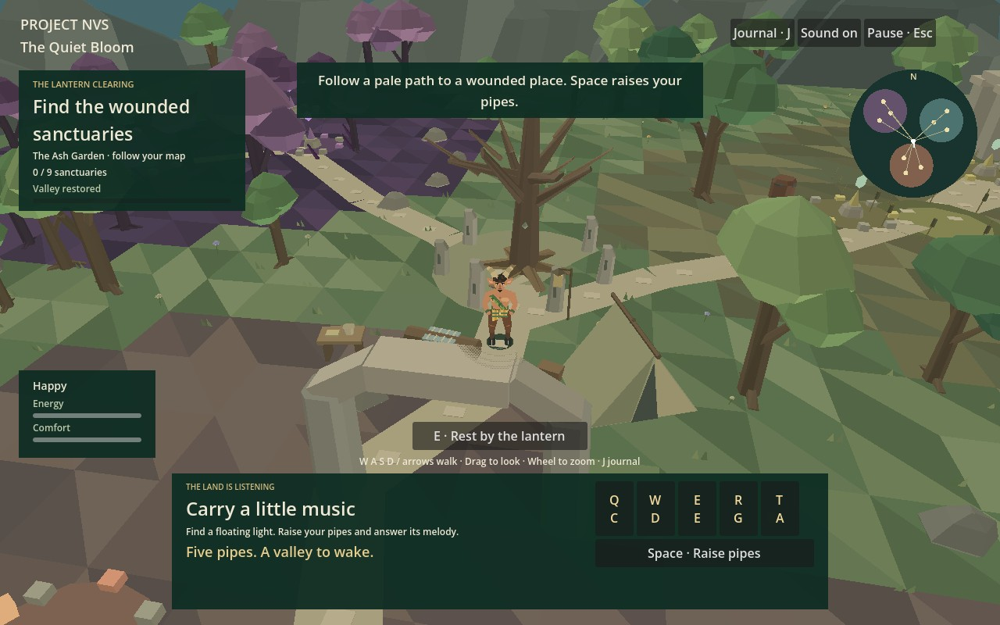
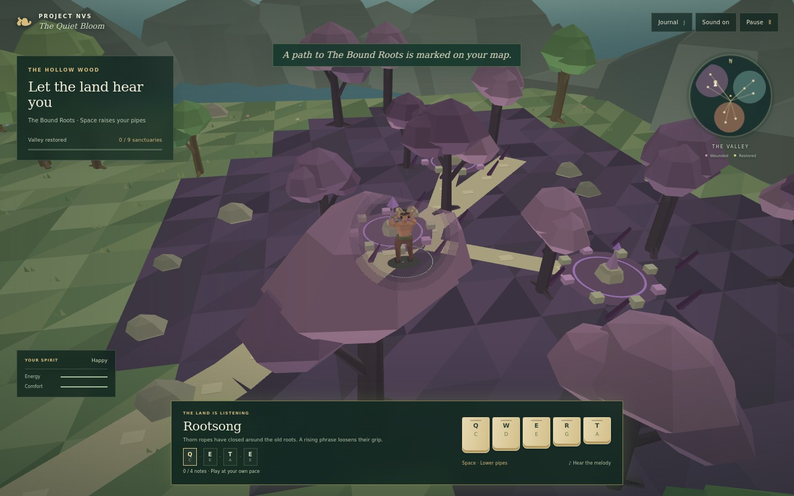
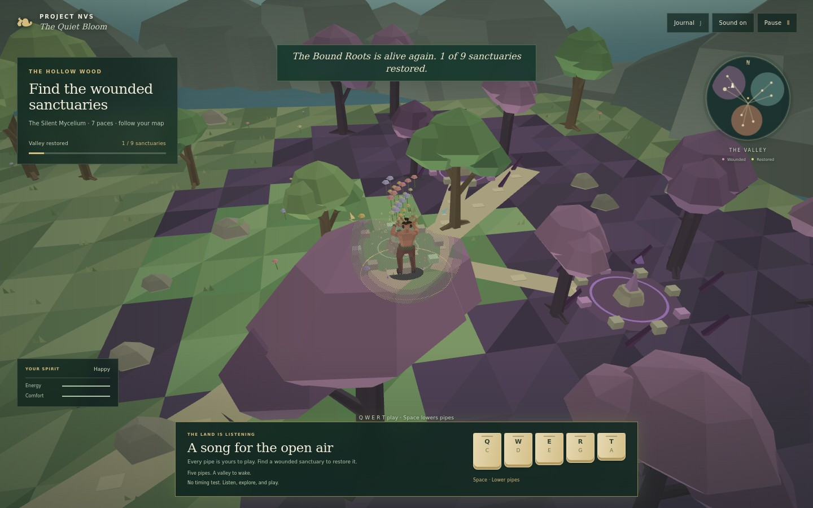

# Project NVS: The Quiet Bloom

A faun carries a set of wooden pipes into a wounded valley. Play the land's remembered melodies to loosen corruption, clear polluted water, and coax new growth from scorched earth.

**The Quiet Bloom** is the provisional title for Project NVS. This first playable game combines adapted code from MBean1, Zendelves, and Lifesim in a small, complete restoration journey.



## Open in Godot

This repository now includes the native **Godot 4.7.2** project at its root.

1. Download a fresh repository ZIP and extract it completely.
2. In Godot Project Manager, choose **Import** and select the root `project.godot`.
3. Open the project and press **F5** to play.

The Godot edition runs the 3D game, animated faun, nine restoration sites, panpipes, camp, journal, map, saves, and final heart song directly. No Node.js, local web server, browser, or extension is required. Native saves are stored in `user://journey.json`, separately from browser saves.



A Windows Desktop export preset is included. Export templates are needed only when exporting a standalone executable, not for opening and playing the project in Godot.

## Browser prototype

The original browser edition remains available. To run it, use Node.js 20 or later:

```sh
npm start
```

Open [http://localhost:5173](http://localhost:5173). The Godot edition above is the default path for working on this project.

## Restore the valley

Follow the pale paths to the floating sanctuary lights. Raise your pipes with Space, listen to the phrase, then play its displayed keys in order. The melody checks note order at your own pace. There is no timing window, score penalty, or game-over screen.

The Hollow Wood, the Bitter Marsh, and the Ember Orchard each contain three wounded sites. Their melodies grow from four to six notes. Every completed phrase changes the surrounding terrain, plants, and water. Restored sites gain flowers and returning butterflies.

After all nine sanctuaries recover, return to the central heart tree. Play its final seven-note melody to complete the journey. You can continue exploring and playing afterward.

| Control | Action |
| --- | --- |
| W A S D or arrow keys | Walk while your pipes are lowered |
| Left Shift | Walk briskly |
| Drag the scene | Orbit the camera |
| Mouse wheel | Zoom |
| Space | Raise or lower the pipes |
| Q W E R T | Play C, D, E, G, A while the pipes are raised |
| Listen button | Hear the nearby sanctuary's phrase |
| E | Rest beside the lantern camp while the pipes are lowered |
| J | Open the journal and choose a sanctuary waypoint |
| Escape | Pause or resume |
| Sound button | Mute or unmute |

The on-screen note buttons work with a pointer. Small screens also show movement buttons. While the pipes are raised, W and E play notes. Lower the pipes to use walking and resting controls.

Energy, comfort, and frustration change the faun's mood. They never prevent movement or music. A four-second rest at the lantern camp restores energy and comfort. Walking away cancels the rest.

## Your journey is saved here

The Godot game saves to its native user folder every five seconds, after restoration, and when paused or closed. The browser prototype saves separately in the current browser. **Continue** restores your position, sanctuary progress, needs, and ending state. Browser site data and native user-folder saves are independent.

## Watch a place recover

| Before the song | After the song |
| --- | --- |
|  |  |

## Scope of this version

This is a single-player exploration game with one authored valley, nine restoration sites, a playable procedural faun, live synthesized music, and an ending. It has no combat, building mode, multiplayer, or full music editor. Its five-note instrument and melody matching are purpose-built for restoration.

All models and terrain are generated in code. The music uses an authored synthesizer adapted from MBean1's reed voice. It contains no borrowed music recordings or downloaded instrument samples.

See [the architecture](docs/ARCHITECTURE.md), [the source reuse record](docs/SOURCE_REUSE.md), and [implementation progress](PROGRESS.md). Source links to the private projects require access to those repositories.

## Development commands

```sh
npm test
npm run check
```

These commands run 14 simulation, save, geometry, restoration, and route reachability checks, plus syntax checks. The browser journey and audio graph have separate replayable checks. For those development checks only, install Playwright and its Chromium browser, then run:

```sh
node tools/browser-smoke.mjs
node tests/audio-browser.cjs
```

Set `CHROMIUM_PATH` to use an existing browser executable. [Browser results](docs/browser-verification.json), [audio results](docs/audio-verification.json), and [PROGRESS.md](PROGRESS.md) record the verification performed on this version.


## Native verification and asset regeneration

Run the native integration test with Godot 4.7.2:

```sh
godot --headless --path . --script tests/godot_smoke.gd
```

It exercises the native scene, movement input, all nine sites, the ending, actual save/Continue, malformed save handling, rest, and native PCM audio data. See [Godot verification](docs/godot-verification.json) and [native port notes](docs/GODOT_PORT.md).

Native meshes and generated pipe samples are included in `assets/`. They can be regenerated during development from the browser source with `node tools/bake-native.mjs` and `python tools/bake-native-audio.py`. Regeneration is optional for playing or editing the native gameplay scripts.
